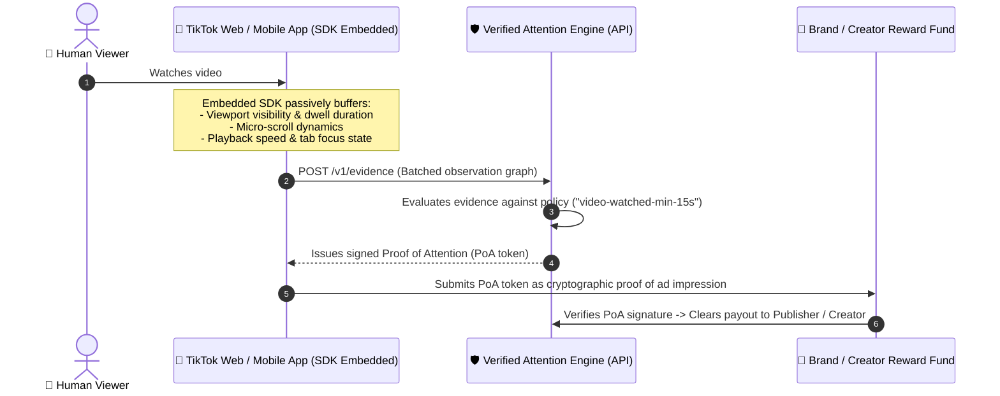
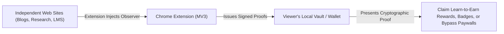

# How Verified Attention Protocol (VAP) Works: End-to-End Guide

## Introduction: Why Verified Attention is Urgent in the Age of AI

Human attention is the scarcest and most valuable economic resource on the Internet. Yet, current digital infrastructure lacks any reliable mechanism to independently verify that a human genuinely engaged with digital material. Two transformative real-world problems highlight why this capability is now essential:

### 1. The Crisis in Learning & Education in the AI Era
In the age of generative AI, traditional take-home assignments, quizzes, and self-reported modules have broken down. Students and corporate learners can prompt an LLM to generate flawless answers in seconds, acing tests and claiming certificates while learning little to nothing. 

Educators and institutions can no longer grade static submissions. What matters is **provable cognitive readership**:
- Did the learner actually read through the technical material, legal disclosure, or textbook?
- Did their reading cadence show realistic human micro-entropy, dwell pauses, and gaze-scroll alignment?
- Did they spend genuine cognitive effort before arriving at an answer?

VAP provides educators and certification bodies with **cryptographically verifiable Proofs of Readership**, turning the learning process itself into an auditable, un-fakeable credential.

### 2. Disintermediating the Broken Advertising Economy
On platforms like YouTube and digital media networks, sponsors pay content creators and ad networks billions of dollars based on superficial proxy metrics: page views, raw clicks, or video impression counts. In reality:
- Ads are routinely skipped after the mandatory 5-second countdown.
- Tabs are muted in the background or minimized while autoplay runs.
- Viewers pay zero attention, yet sponsors pay full price blindly.

With VAP, merchants obtain **cryptographic evidence of actual human viewership**. Even more revolutionary: merchants can bypass expensive middlemen and platform monopolies entirely by **paying viewers directly**. Instead of paying $50,000 to an intermediary hoping an audience notices a sponsored placement, an advertiser can stream micropayments directly to verified humans who provide proof of engaged attention. This eliminates fraudulent intermediaries, drastically reduces advertiser acquisition costs, and compensates users directly for their most valuable asset: their attention.

---

### The Evidence-Centric Architecture (ECA)

At its core, VAP replaces self-serving platform claims with an immutable, verifiable pipeline:
```
Observation ──▶ Evidence ──▶ Claim ──▶ Confidence ──▶ Verification ──▶ Proof of Attention (PoA) ──▶ Settlement / Value Exchange
```

This guide explains:
1. **Client SDKs & Developer Tooling**: How interaction observers work today in development and how they scale to cloud production.
2. **Real-World Integration Models**: First-Party Platform Integration (e.g., TikTok, Coursera, video players) versus Third-Party Decentralized Attestation (the Browser Extension model).

---

## Part 1: Client SDKs & Developer Tooling in Practice

The VAP ecosystem provides three primary client tools for developers and participants:
* **Browser SDK** (`packages/sdk/browser`)
* **Publisher Chrome Extension** (`packages/sdk/extension`)
* **Developer CLI (`vap`)** (`packages/cli`)

### 1. Browser SDK (`@verified-attention/sdk-browser`)

The Browser SDK is the primary integration library for web publishers, streaming applications, and educational platforms.

```mermaid
flowchart TD
    subgraph DevMode["Current State (Local Testing / Development)"]
        A1[Web Application] -->|Passive Observers| B1[In-Memory / LocalStorage Queue]
        B1 -->|Periodic Flusher| C1["Local REST API (http://localhost:3000/v1/evidence)"]
        C1 -->|Validation & Scoring| D1[Local Memory / SQLite / JSONL Store]
    end

    subgraph ProdMode["Production State (Cloud Scale)"]
        A2[Web Application] -->|Web Worker (Off Main Thread)| B2[Encrypted Ring Buffer]
        B2 -->|navigator.sendBeacon / keepalive| C2["Edge CDN / Ingestion Gateway (api.vap.io)"]
        C2 -->|Kafka / Redis Streams| D2[Real-Time Verifier Pool & Cloud HSM]
    end
```

#### Current State (Local Development)
- **Passive Observers**: Hooks into DOM event listeners without harvesting biometrics:
  - **Focus & Visibility**: `visibilitychange`, `window.onblur`, `window.onfocus`.
  - **Interaction Dynamics**: Throttled pointer movements, scroll velocity, micro-pause cadence, dwell transitions.
- **Offline-Tolerant Queue**: Events buffer in memory with fallback to browser `localStorage` (`StorageAdapter`).
- **Session Lifecycle**: `startSession(contentId, participantId)` batches observations and flushes payloads via HTTP `fetch` to `http://localhost:3000/v1/evidence`.
- **Mock Attestation**: WebCrypto generates SHA-256 evidence digests, and the local dev engine verifies signatures using test keys.

#### Production State
- **Zero Main-Thread Overhead**: Observers execute inside a dedicated **Web Worker**, ensuring high-frequency scroll and dwell calculations never cause UI frame drops or layout thrashing.
- **Resilient Transmission**: Uses `navigator.sendBeacon()` or `fetch({ keepalive: true })` so un-flushed evidence reaches the verifier even if the user abruptly navigates away or closes the tab.
- **Hardware & Origin Attestation**: Integrates browser integrity primitives (WebAuthn / Device Integrity) to certify the client runtime is an authentic browser without identifying the user.
- **Privacy Minimization**: Automatically strips query parameters, personal form inputs, and IP metadata before evidence leaves the client boundary.
- **Distribution**: Distributed via npm (`npm install @verified-attention/sdk-browser`) and lightweight CDN bundles (`https://cdn.vap.io/v1/vap.min.js`).

---

### 2. Publisher Chrome Extension (`packages/sdk/extension`)

#### Current State (Local Development)
- **Manifest V3 Architecture**:
  - `content.ts`: Injected into target tabs to passively capture reading dynamics and micro-scrolls.
  - `background.ts`: Service worker managing state messages (`MESSAGE_SESSION_START`, `MESSAGE_EVIDENCE_INGEST`).
  - `popup.html` / `popup.ts`: Local extension UI displaying real-time session duration, confidence, and proof status.
- **Target Environment**: Loaded manually via Chrome Developer Mode (`chrome://extensions` &rarr; *Load unpacked*). Hardcoded to send evidence to `http://127.0.0.1:3000`.

#### Production State
- **Chrome Web Store Distribution**: Signed, auto-updating extension distributed across Chromium browsers (Chrome, Edge, Brave).
- **Decentralized Publisher Discovery**: Dynamically detects whether visited sites publish a `/.well-known/vap.json` configuration file, automatically applying the site's verification policy.
- **Viewer-Owned Attention Vault**: Stores issued Proofs of Attention (PoA) in an encrypted local browser vault. The viewer can present these proofs to claim rewards, prove training completion, or bypass paywalls across disparate web platforms without revealing their identity.

---

### 3. Developer CLI (`packages/cli` & `vap`)

#### Current State (Local Development)
- **Command Structure**: Executed via `node packages/cli/dist/index.js` or `vap`.
- **Core Operations**:
  - `vap verify <file>`: Structurally validates a JSON proof against the normative Zod `ProofSchema`.
  - `vap verify <proofId>`: Queries the local API (`GET http://localhost:3000/v1/proofs/:id`).
  - `vap session create|close|get`: Programmatically creates and queries sessions against the local cluster.
  - `vap evidence ingest <file>`: Posts raw evidence batches to test ingestion pipelines.
- **Zero Closed Dependencies**: Completely decoupled from proprietary components; interacts purely with open REST contracts.

#### Production State
- **Global Package Manager Distribution**: Installed globally via `npm install -g @verified-attention/cli` or `brew install vap-cli`.
- **Context & Keyring Management**: Securely stores API tokens in the operating system's native keychain (macOS Keychain, Linux Secret Service). Supports multi-environment cluster switching:
  ```bash
  vap config set-context production --api-url https://api.vap.io
  ```
- **CI/CD Integration & Conformance Auditing**:
  - `vap audit <proofId> --verify-chain`: Audits an issued Proof of Attention against public DID/DNS keys and verification certificate revocation lists.
  - Automated CI conformance pipeline checks:
    ```yaml
    - run: vap test-conformance --endpoint https://staging.verifier.example.com
    ```

---

## Part 2: Real-World Integration Models

A common question is: **Do viewers need to install a browser extension to verify video engagement on a platform like TikTok?**

**No.** The Chrome Extension is not required for first-party platforms. VAP operates under two distinct architectural models:

```
┌────────────────────────────────────────────────────────────────────────┐
│                        VAP INTEGRATION MODELS                          │
├──────────────────────────────────┬─────────────────────────────────────┤
│ 1. First-Party Integration       │ 2. Third-Party / Viewer Vault       │
│    (e.g., TikTok, Coursera, NYT) │    (Decentralized Attestation)      │
├──────────────────────────────────┼─────────────────────────────────────┤
│ • Developers embed Browser/App   │ • Viewer installs Chrome Extension  │
│   SDK directly in release        │   from Web Store                    │
│ • Viewer requires NO extension   │ • Viewer browses independent blogs, │
│ • Completely invisible to user   │   articles, or un-instrumented web  │
│ • Proofs sent to advertiser or   │ • Proofs stored in user's private   │
│   settlement clearinghouse       │   attention vault / wallet          │
└──────────────────────────────────┴─────────────────────────────────────┘
```

---

### Model A: First-Party Platform Integration (The TikTok Example)

TikTok is a first-party platform: their engineering team controls their website, mobile apps, and video playback client. They do not require viewers to install an extension.



1. **SDK Embedded in the Application Bundle**:
   The developer imports `@verified-attention/sdk-browser` into their web player (or the native VAP SDK into their iOS/Android mobile codebase).
2. **Passive, Unobtrusive Observation**:
   While the viewer watches video content naturally, the embedded SDK records interaction signals:
   - Was the video player container in the active viewport?
   - Was audio enabled and the browser tab focused?
   - Did dwell time and scroll-away transitions reflect human mechanical entropy (vs. automated script loops)?
3. **Automated Verification**:
   The embedded SDK flushes evidence directly to the VAE backend (`/v1/evidence`), which issues an Ed25519-signed Proof of Attention (`PoA`).
4. **Zero Viewer Friction**:
   The user does not install any extension, solve CAPTCHAs, or adjust browser settings. They simply consume content.

---

### Model B: Third-Party Decentralized Attestation (The Chrome Extension)

The Chrome Extension (`packages/sdk/extension`) exists for the opposite scenario: when the publisher **does not** have the SDK installed, or when the **viewer** wants to independently custody cryptographic proofs of their own attention.



1. **Un-Instrumented Publishers**:
   When viewing articles across independent blogs, Substack, Wikipedia, or news portals that have not integrated the VAP SDK, the viewer's extension monitors their reading session locally.
2. **User-Custodied Attention**:
   Instead of the publisher holding the proof, the viewer retains signed PoA tokens in their own local vault.
3. **Portable Credentials**:
   The viewer can present these signed proofs to:
   - Prove mandatory compliance or course completion across external portals.
   - Earn learning rewards or token disbursements based on verified dwell time.
   - Unlock attention-metered paywalls without paying subscriptions or surrendering identity.

---

## Summary Comparison Matrix

| Dimension | First-Party SDK Integration (TikTok Model) | Third-Party Extension (Viewer Vault Model) |
| :--- | :--- | :--- |
| **Who Integrates It?** | Platform / publisher developers embed the SDK | Individual viewer installs from the Chrome Web Store |
| **Viewer Effort** | **Zero**. Viewer interacts naturally | Viewer installs extension and manages permissions |
| **Primary Beneficiary** | **Publisher & Advertiser** (guaranteed viewability, bot fraud elimination, verified billing) | **Viewer** (custodies independent cryptographic proof of their own engagement) |
| **Execution Environment** | Embedded in the web application or native mobile app | Isolated background service worker in Chromium browsers |
| **Evidence Routing** | Directly from platform client to publisher's VAE cluster | From extension to configured community or third-party verifier |
| **Proof Custody** | Publisher platform receives and submits PoA to advertisers | Viewer's browser extension stores PoA in local private vault |
