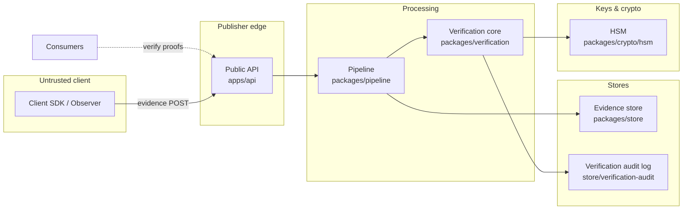

# Threat Model — Verified Attention Engine (VAE)

**Status:** Baseline (S1 gap closure) · **Date:** 2026 audit round · **Scope:** VAP reference implementation in this repository.

This document defines the adversary model, protected assets, trust boundaries, and component-level threat analysis (STRIDE) for the VAE, and maps each mitigation to controls that exist in the repository. It is deliberately honest about gaps: the reference implementation is a prototype, and several controls are stubs (see `docs/AUDIT.md` §4).

---

## 1. Adversary Model

We assume network-level transport security (TLS) but no trust in any submitted input. Adversaries, in rough order of expected frequency:

| Adversary | Capability | Goal |
|---|---|---|
| **Bot / scripted client** | Generates synthetic observations (headless browsers, emulators, replayed signals) | Obtain PASS decisions and Proofs of Attention without human attention |
| **Click farm (human)** | Low-cost humans performing minimal, non-genuine engagement; coordinated timing across accounts | Pass fraud screens at scale; extract reward funds |
| **AI simulation** | Generative models that reproduce realistic interaction traces | Defeat behaviour-based classification (arms race) |
| **Sybil attacker** | Creates many pseudonymous sessions/identities | Amplify rewards; evade per-identity rate limits and reputation |
| **Replay attacker** | Captures and resubmits previously valid evidence or proofs | Mint decisions/proofs from stale or duplicated submissions |
| **Evidence forger** | Tamers with evidence in transit or at rest; fabricates evidence payloads | Corrupt evidence integrity, claim derivation, or audit trail |
| **Malicious publisher** | Inflates metrics, redefines policies opportunistically, submits host-injected evidence, or misstates content identity | Increase inventory value at advertiser/consumer expense |
| **Malicious viewer** | Colludes with publisher or farms own sessions; denies consent post-hoc; manipulates client time | Game rewards or poison datasets |
| **Malicious verifier** | Issues proofs without genuine evaluation; mis-applies policy; signs with misused keys | Mint fraudulent proofs; devalue all proofs from that verifier |
| **Malicious consumer** | Over-interprets proofs (treats them as identity evidence), links proofs across sessions | Re-identification of viewers; surveillance creep |
| **Insider** | Operator/admin access to stores, keys, logs, reward settlement | Exfiltrate viewer data, mint proofs, or drain reward funds |

Non-goals for this baseline: nation-state actors with hardware supply-chain access, and full compromise of the verifier's host (a verifier operating on untrusted hardware is out of scope until remote attestation is added).

---

## 2. Assets

| Asset | Security property required |
|---|---|
| **Evidence integrity** | Evidence is immutable once validated and stored; provenance (session, timestamp, source) is trustworthy |
| **Proof authenticity** | A Proof of Attention is unforgeable; signature verifies against the published verifier key; proof binds to evidence hash and policy |
| **Viewer privacy** | No raw sensor data stored; no persistent identifiers in evidence; consent respected; pseudonymised identifiers are unlinkable across sessions |
| **Reward funds** | Rewards settle only against verified, non-duplicated proofs; no double-spend |
| **Verifier signing keys** | Non-extractable in production; usage auditable |
| **Confidence reproducibility** | Same evidence + same policy + same model version → same confidence (deterministic verification) |

---

## 3. Trust Boundaries

| Boundary | What crosses | Trust assumption |
|---|---|---|
| Client → API | Observations/evidence over TLS | Client input is adversarial until validated; SDK cannot be trusted to self-report truthfully |
| API → Pipeline | Validated evidence | API enforces authN/authZ; pipeline enforces schema, timestamp sanity, session binding, replay protection |
| Pipeline → Stores | Immutable evidence items | Store enforces append-only semantics; ingestion is the last point of rejection |
| Verifier → HSM | Sign/verify operations | Keys do not leave the HSM boundary; reference impl uses software-backed keys (see §5 gaps) |
| API/Stores → Consumers | Proofs + verification status | Consumers authenticate (API key/JWT) and are scoped by RBAC role |

---

## 4. STRIDE per Component

▮ = meaningful, ○ = limited/mitigated by design. Details follow for components where analysis is meaningful.

### 4.1 Client SDK (untrusted by assumption)

| Threat | Notes | Control |
|---|---|---|
| Spoofing | SDK identity cannot be attested; any HTTP client can imitate it | Evidence claims are treated as *observations*, never as trusted assertions; confidence derived deterministically from multi-signal evidence, not a single client-declared flag |
| Tampering | Client may alter JS, timestamps, ordering | Server-side timestamp sanity + session binding (`packages/pipeline/src/validation.ts`); evidence ordering validated against session state machine |
| Repudiation | Viewer denies participation | Consent records retained (5y) via `packages/privacy/consent` |
| Information disclosure | Over-collection from client | Data minimisation at pipeline level; SDK collects only policy-tier evidence |
| DoS | Client floods evidence | Rate limits/front-worth at API; session-scoped evidence caps (policy) |
| Elevation | Client claims producer/publisher status | API authN; publisher identity is server-issued, not client-asserted |

### 4.2 Public API (`apps/api`)

- **Spoofing:** API-key + JWT authN (`apps/api/src/security`); publisher/consumer identities server-issued.
- **Tampering:** Input validation (zod schemas) at the route boundary; evidence pipeline re-validates.
- **Repudiation:** Request correlation IDs (`apps/api/src/correlation.ts`); verification audit log (§4.5).
- **Information disclosure:** RBAC scopes (Admin/Operator/Reviewer/Publisher/Consumer) restrict proof and session reads; privacy routes enforce minimisation on export.
- **DoS:** *Gap* — no production WAF/rate-limiting evidence; assumed to be deployed at the gateway layer (gateway itself is a known S19 gap).
- **Elevation:** RBAC middleware (`getRBAC()`); default-deny per route.

### 4.3 Pipeline (`packages/pipeline`)

- **Spoofing:** Session binding — evidence MUST reference an ACTIVE session (`pipeline.ts` validation stage).
- **Tampering:** Schema validation, timestamp normalisation (`normalization.ts`).
- **Replay:** `ReplayCache` interface with `InMemoryReplayCache` — duplicate evidence IDs rejected at validation and/or append. ⚠ *Gap:* the shipped implementation is in-memory only; a distributed deployment needs a shared (e.g., Redis-backed) replay cache to survive restarts and multi-instance ingestion.
- **Information disclosure:** Minimisation policy strips/hashes PII fields before persistence (`packages/privacy/minimisation`).
- **DoS:** Max-age rejection (`maxAgeMs`), evidence size/type constraints.
- **Elevation:** N/A (no privilege co-model inside pipeline).

### 4.4 Verification core (`packages/verification`)

- **Spoofing:** Verifier identity = signing key identity (see 4.6).
- **Tampering:** Policy engine decision must be deterministic; confidence model rules fixed per version. ✎ *Gap:* no signed policy versions yet — a misconfigured policy could silently change decisions; policy documents should be hashed into proofs (VAP future work).
- **Repudiation:** Every decision appended to the verification audit log (4.5).
- **Info disclosure / DoS:** Limited; verification operates on validated evidence.
- **Elevation:** Policy management is RBAC-gated (Publisher/Operator roles only).

### 4.5 Audit log (`packages/store/verification-audit`)

Append-only log of verification decisions supporting replay/forensics.
- **Tampering:** ✎ *Gap* — log integrity is not chained (no hash-linking or external anchoring); an insider with store write access could rewrite history. Mitigation path: hash-chain or transparency-log anchoring (post-1.0).
- **Repudiation/Spoofing/DoS:** Standard store protections apply.

### 4.6 Signing keys / HSM (`packages/crypto/hsm`, `packages/verification/hsm.ts`)

- **Spoofing/Tampering:** Proof signatures via ECDSA P-256. `SoftwareHSM` (node:crypto) implemented; `StubHSM` retained as deprecated alias.
- **Information disclosure (of keys):** ⚠ *Gap vs production posture* — software keys are extractable from the host; production requires a real HSM/KMS (cloud-KMS adapters currently fall back with a warning). Cloud adapters exist but are not hardened/tested against a live KMS.
- **Repudiation:** Sign operations SHOULD be audit-logged with key IDs; key rotation policy documented in `sprint-06/verifier-key-management`.

### 4.7 Reward engine (`packages/reward/*`)

- **Spoofing/Rewards abuse:** Settlement tied to verified proofs; dedup on proof ID prevents double-pay.
- **DoS:** Batch settlement surfaces reviewed in S11.
- **Elevation:** Settlement ops restricted to Operator role.
- ✎ *Gap:* economic attacks (reward-rate gaming at the policy level) are not mitigated by crypto controls; rely on fraud ML + policy review.

### 4.8 Fraud/attention ML (`packages/ml`, packages/ml/attention, fraud)

- **Tampering (model poisoning):** Training data provenance not yet enforced; drift/retrain pipeline is a known S8 gap.
- **Info disclosure:** Models may leak training-data properties; *open question* (research agenda item).
- Confidence calibration assets exist (`calibration_platt.png`, `calibration_isotonic.png`, `calibration_uncalibrated.png` at repo root).

### 4.9 Stores (`packages/store/*`)

- **Tampering:** Append-only evidence store validates as the last rejection point.
- **Info disclosure:** Encryption at rest via `packages/security/encryption-at-rest`; ⚠ TLS certs (`packages/security/tls`) and secrets (`packages/security/secrets` encrypt/decrypt no-ops) are placeholders — marked gaps from the audit.

---

## 5. Mitigations Mapped to Existing Controls

| Threat | Existing control | Location | Status |
|---|---|---|---|
| Replay of evidence | Replay cache (duplicate-ID rejection) + max-age | `packages/pipeline/src/validation.ts` | ✅ implemented (in-memory; distributed variant = gap) |
| Forged proofs | ECDSA P-256 signing | `packages/crypto/hsm` (SoftwareHSM) | ✅ software-backed; ⚠ HSM-backed keys still outstanding |
| Covert collection | Consent manager with withdrawal | `packages/privacy/consent` | ✅ implemented |
| Excessive data collection | Policy-driven minimisation (strip/hash) | `packages/privacy/minimisation` | ✅ implemented (audit fix 0a resolved default-policy bug) |
| Identifier linkage | HMAC-SHA256 pseudonymisation (salted) | `packages/privacy/pseudonymisation` | ✅ implemented |
| Retention violation | Automated retention engine + legal hold | `packages/privacy/retention` | ✅ implemented |
| Unauthorised access | RBAC (5 roles) + API key/JWT | `packages/auth`, `apps/api/src/security` | ✅ implemented |
| Insider repudiation | Append-only verification audit log | `packages/store/verification-audit` | ◐ present; no hash-chaining (gap) |
| Encryption in transit/at rest | TLS manager; encryption-at-rest engine | `packages/security/tls`, `security/encryption-at-rest` | ◐ at-rest ✅; TLS certs placeholder; secrets encryption no-op (gap) |
| Fraud (bots/farms/sybil) | Fraud ML classifiers | `packages/ml` (fraud) | ◐ code present; AUC claims unverified (AUDIT §2) |

## 6. Known Gaps (from `docs/AUDIT.md`)

1. **TLS/secrets stubs:** placeholder self-signed certs; secrets encrypt/decrypt are no-ops.
2. **Distributed replay cache:** in-memory only.
3. **Audit-log integrity:** no hash chaining / external anchoring.
4. **Programming supply chain:** no signed SBOM attestations (SBOM exists at `docs/security/sbom.json` but is unversioned against releases).
5. **Policy integrity:** policies not cryptographically versioned into proofs.
6. **SDK absence:** SDK packages are 1-file skeletons — all client-side protections are theoretical until S16–S18 land.
7. **Gateway/DoS controls:** API gateway and rate limiting are roadmap items (S19).
8. **Model governance:** no drift detection/retrain pipeline (S8 gap); training-data provenance unenforced.

## 7. Out of Scope (this document)

Infrastructure hardening (Kubernetes, network segmentation), browser/OS platform policy changes, and formal verification of the protocol state machines. These belong in the deployment/ops docs and the protocol's conformance framework respectively.

---

**Next review:** After S16 (real SDK) and S19 (gateway), or on any change to evidence formats.
